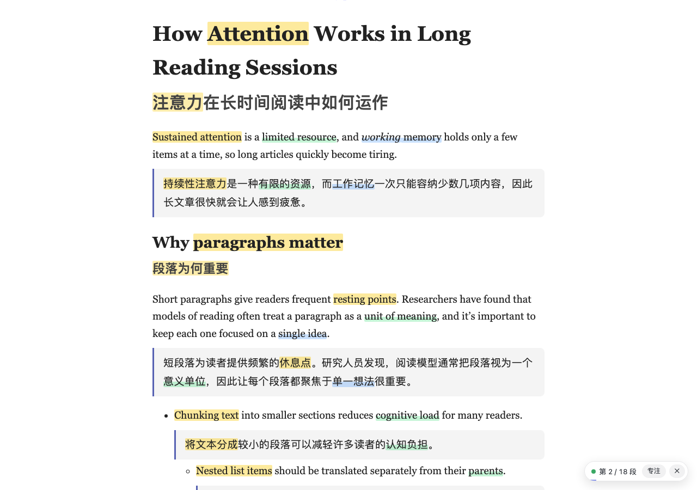
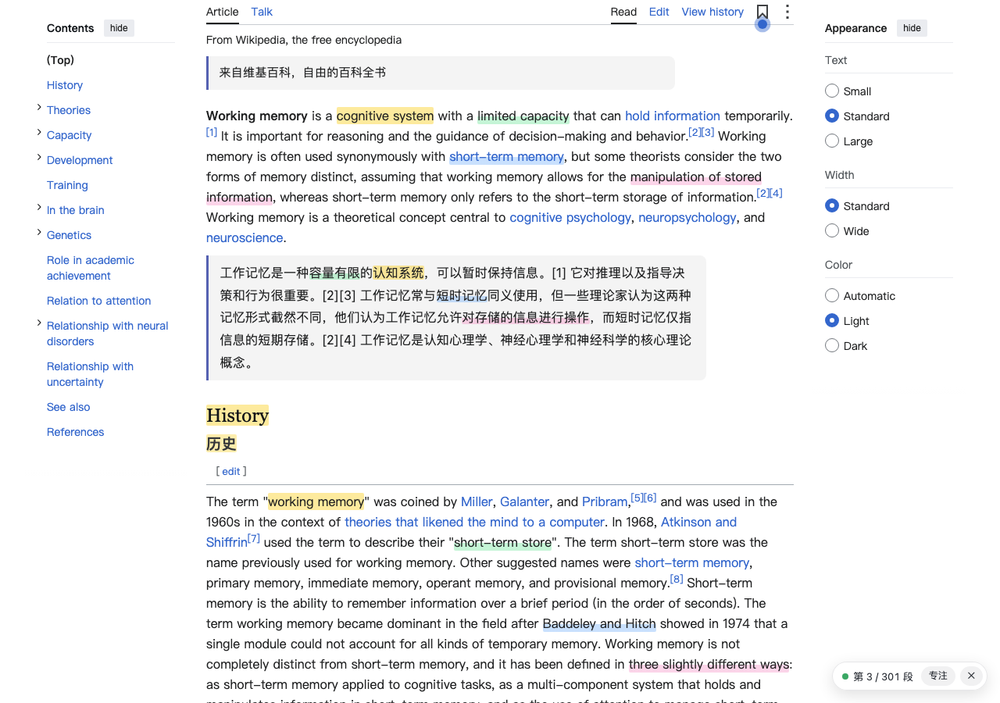

# 专注双语阅读 · Focus Bilingual Reader

一个 Chrome 扩展：按 **Alt+T**，把网页里的英文逐段译成中文，**原文和译文上下对照**，并用颜色标出每段的**重心词**。专为有 ADHD、读长文容易走神的人设计。

翻译调用 [DeepSeek](https://platform.deepseek.com/) 的接口，需要自备 API Key。 · [English](#english)



## 功能

- **逐段对照**：译文紧跟在每段原文下面，一段原文加一段译文是一个阅读单元。标题、列表、引用都会翻译；导航、页脚、代码、按钮，以及本来就是中文的段落保持不动。
- **重心词高亮**：每段挑出几个最能代表这段意思的词，英文和对应的中文用同一种颜色标出，整块黄底的是最核心的那个。鼠标指向一个词，原文和译文里成对的两个词会一起描边。
- **专注模式**：突出当前读到的那一段，其它内容变淡，跟着滚动走。默认关闭。
- **边读边译**：只翻译屏幕附近的段落，往下滚再接着译。译文流式返回，第一段通常 1–2 秒就出来。
- **本地缓存**：译过的段落存在本机，再打开同一篇不会重复请求，也不再花钱。
- **一键还原**：再按一次 Alt+T，页面恢复原样。
- **权限少**：只在你点了它的那个标签页里运行，不需要「读取所有网站」的权限。

## 安装

目前没有上架 Chrome 应用商店，需要用开发者模式加载：

1. 下载代码：点本页上方的 **Code → Download ZIP** 后解压，或者

   ```bash
   git clone https://github.com/Chen1un17/focus-bilingual-reader.git
   ```

2. 在 Chrome 地址栏打开 `chrome://extensions`，打开右上角的 **开发者模式**。
3. 点 **加载已解压的扩展程序**，选择这个文件夹（有 `manifest.json` 的那一层）。

需要 Chrome 116 或更新的版本。文件夹要放在不会被删掉的地方，移动或删除后需要重新加载。更新代码后，在 `chrome://extensions` 点扩展卡片上的刷新按钮 ↻。

## 配置

1. 在 [DeepSeek 开放平台](https://platform.deepseek.com/api_keys) 创建一个 API Key（账户里要有余额）。
2. 装好扩展后会自动打开设置页。填入 Key，点 **测试连接**，看到「连接成功」就可以用了。

设置页里还能改这些：

| 设置 | 选项 |
|---|---|
| 模型 | `deepseek-flash`（V4.1 Flash，默认，快又便宜）、`deepseek-v4-pro`（更强，价格约 4.5 倍），或自己填模型名 |
| 每段重心词 | 克制 1–2 个 / 适中 2–3 个（默认）/ 丰富 3–5 个 |
| 译文字号 | 跟随原文 / 大一号 / 大两号 |
| 专注模式 | 打开双语时是否直接进入 |
| API 地址 | 用中转或代理时才需要改；换成别的域名后，浏览器会请你授权访问它 |

### 可选：预置 API Key

在扩展文件夹里新建 `preset.json`：

```json
{ "apiKey": "sk-你的Key" }
```

安装扩展时，或者第一次使用时还没填 Key，里面的值会自动填进还空着的设置项；设置页里已经填过的不会被覆盖。适合在多台电脑或多个 Chrome 用户上装同一份扩展。

`preset.json` 已经写进 `.gitignore`，不会被提交。**把扩展发给别人之前一定要删掉它**，否则别人会用你的 Key、花你的钱。

## 使用

| 想做的事 | 怎么做 |
|---|---|
| 开启 / 关闭双语 | 点工具栏图标，或按 **Alt+T**（Mac 上是 ⌥T），或右键 →「双语对照阅读本页」 |
| 看某个词对应的翻译 | 鼠标指向高亮的词，原文和译文里成对的那个会同时描边 |
| 只看当前这一段 | 点右下角小面板上的「专注」 |
| 某段没翻译成功 | 点那一段下面的「重试」 |
| 关掉 | 再按一次 Alt+T，或点面板上的 ✕ |

同一种颜色 = 同一对词（英文 ↔ 中文）。整块黄色底的是这一段最核心的词，其它是半高的荧光笔底纹。



<sub>截图里的英文原文来自维基百科「[Working memory](https://en.wikipedia.org/wiki/Working_memory)」条目，采用 [CC BY-SA 4.0](https://creativecommons.org/licenses/by-sa/4.0/) 授权。</sub>

## 为什么这样设计

样式按公开的可读性和认知无障碍建议来定，每一条都对应一个具体的选择：

| 建议 | 来源 | 在扩展里的做法 |
|---|---|---|
| 中日韩文字每行不超过 40 字；行距至少 1.5 倍；不要两端对齐 | [WCAG 1.4.8](https://www.w3.org/WAI/WCAG21/Understanding/visual-presentation) | 译文块最宽 40em（约 40 个汉字），行高 1.8，左对齐 |
| 一段一个意思，块与块之间留白，方便走神后找回位置 | [W3C COGA](https://www.w3.org/TR/coga-usable/) | 一段原文 + 一段译文作为一个单元，译文块有左侧色条和浅底色 |
| 少用动画，动效只用来提示“这里变了” | [BOIA](https://www.boia.org/blog/adhd-friendly-web-design-minimizing-distractions) | 加载占位条是静止的；译文只淡入一次；系统开启“减少动态效果”时全部关闭 |
| 无衬线字体、柔和不刺眼的配色 | [英国读写障碍协会风格指南（摘要）](https://www.smashingmagazine.com/2021/11/dyslexia-friendly-mode-website/) | 译文用系统中文黑体；高亮色降低了饱和度 |
| 适度提示重点有助于理解，但划得太多反而没用 | [信号原则元分析](https://rex.libraries.wsu.edu/esploro/outputs/journalArticle/A-meta-analysis-of-signaling-principle-in/99900601052901842)、[Dunlosky 等 2013](https://courses.lumenlearning.com/wm-introductiontobusiness/chapter/learning-hacks-dont-bother-highlighting/) | 默认每段只标 2–3 个词，其中 1 个是核心词，可在设置里调 |
| 遮罩式阅读尺有人觉得有用，但缺少对照研究 | [Helperbird（厂商说明）](https://www.helperbird.com/features/focus-ruler/) | 「专注」做成可选开关，默认关闭 |
| Bionic Reading（加粗单词前半截）没有可靠证据 | [乌得勒支大学论文](https://studenttheses.uu.nl/handle/20.500.12932/47156) | 没有做这个功能 |

这些多是实践建议，不是定论。哪种设置读起来最舒服，以你自己的感受为准。

## 费用

默认模型 `deepseek-flash`（DeepSeek-V4.1-Flash），并关闭了思考模式，速度更快也更便宜。按[官方价格](https://api-docs.deepseek.com/zh-cn/quick_start/pricing)（输入 1–2 元 / 百万 tokens，输出 4–8 元 / 百万 tokens，北京时间工作日白天是高峰价），一篇约 5000 词的英文长文全部译完，大约几分钱到一毛钱。重复打开走本地缓存，不再计费。价格以官方页面为准。

## 隐私

- API Key 只存在本机：Chrome 的扩展存储里（设成只有扩展自己能读，网页读不到），用了 `preset.json` 的话也在那个文件里。
- 段落原文只发给 DeepSeek（或你在设置里填的 API 地址）用于翻译，不发到别处。扩展没有任何统计或埋点。
- 翻译缓存只存在本机，可以在设置页清除。

## 常见问题

- **点了没反应，或图标上出现 ×**：`chrome://` 页面、Chrome 应用商店、PDF 文件这几类页面不允许扩展运行。
- **提示 API Key 无效或余额不足**：到设置页检查 Key，或到 DeepSeek 开放平台充值，然后点面板上的「重试」。
- **Alt+T 没反应**：可能和别的扩展冲突了，在设置页点「修改快捷键」换一个。

## 工作原理

1. 点图标或按 Alt+T 后，`background.js` 通过 `chrome.scripting` 把 `content.js` 和 `content.css` 注入当前标签页（`activeTab` 权限）。
2. `content.js` 找出正文段落，跳过导航、页脚、代码、按钮和已经是中文的段落；用 `IntersectionObserver` 只把屏幕附近的段落排进队列，每批最多 4 段、1800 个字符，最多 4 批同时请求。
3. `background.js` 流式调用 `POST /chat/completions`（关闭思考模式）。模型按下面的格式逐段输出，每段一闭合就立刻传回页面显示：

   ```
   <seg id="3">
   <zh>译文</zh>
   <kw>English term | 中文词</kw>
   </seg>
   ```

4. 重心词在原文里按词边界匹配，兼容大小写、弯直引号和词形变化（如 model → models）；在译文里先精确匹配，找不到时在同一句里找最接近的片段。
5. 模型漏掉的段落会自动重试，最多 3 次；Key 无效、余额不足这类错误直接在面板上提示。
6. 译文按「提示词版本 + 模型 + 重心词密度 + 原文」的 SHA-1 缓存在 `chrome.storage.local`，超过 8 MB 时删掉较早的一半。

## 开发

没有构建步骤，也没有依赖。改完代码后在 `chrome://extensions` 点 ↻ 就能生效。

```
manifest.json   扩展配置（Manifest V3）
background.js   后台：注入脚本、调用 DeepSeek（流式）、解析、缓存
content.js      页面里：找段落、插入译文、高亮重心词、专注模式、小面板
content.css     页面里的样式
options.*       设置页
icons/          图标
tests/          测试
docs/           README 里的截图
```

测试需要 Node.js 20 或更新的版本：

```bash
node tests/unit.mjs   # 后台逻辑：流式解析、请求格式、出错重试、缓存、预置 Key
node tests/e2e.mjs    # 无头 Chrome 加载扩展，对着本地模拟的 DeepSeek 接口跑完整流程
```

端到端测试覆盖翻译、高亮配对、专注模式、关闭后还原、缓存、出错重试和设置页，截图保存在临时目录。它不调用真实接口，不花钱。默认使用系统里的 Google Chrome，装在别处时用 `CHROME_PATH` 环境变量指定。

接上真实的 DeepSeek 接口，在一篇测试文章、Paul Graham 的长文和维基百科上测过：屏幕附近的段落全部译出，第一段 1–2 秒出现；122 对重心词里有 121 对在原文和译文里都标上了。

欢迎提 Issue 和 PR。

## 许可

[MIT](LICENSE)

---

## English

**Focus Bilingual Reader** is a Chrome extension (Manifest V3) for Chinese-speaking readers. Press **Alt+T** on an English web page and it translates the page paragraph by paragraph into Simplified Chinese, puts each translation right under its original paragraph, and highlights each paragraph's key terms in matching colors on both sides. It was designed for readers with ADHD: one idea per block, short Chinese line length, calm colors, minimal motion, and an optional focus mode that dims everything except the paragraph you are reading.

- Translates with the [DeepSeek API](https://api-docs.deepseek.com/) (`deepseek-flash` by default). Bring your own API key.
- Translates only what is near the viewport, streams results, caches them locally, and restores the page exactly when you turn it off.
- Runs only in the tab where you activate it (`activeTab`). Your API key stays in the extension's local storage.

**Install:** download or clone this repository, open `chrome://extensions`, turn on Developer mode, click **Load unpacked**, and select this folder. Then enter your DeepSeek API key on the options page. The interface is in Chinese.

Licensed under the [MIT License](LICENSE).
